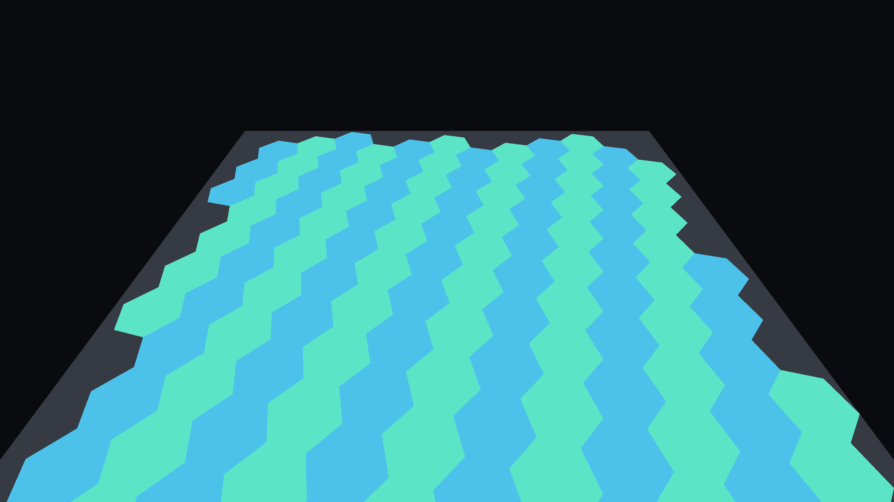
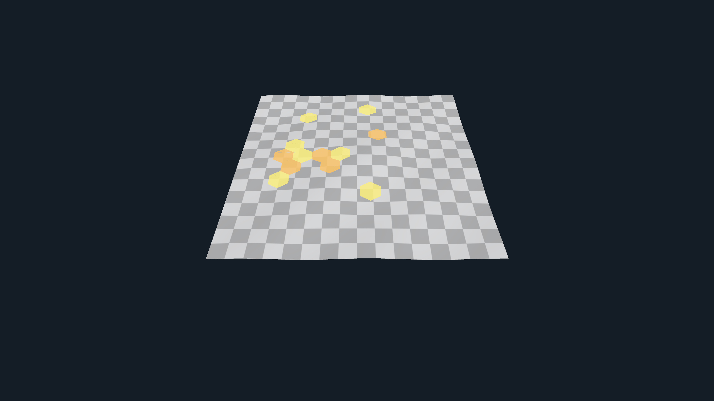
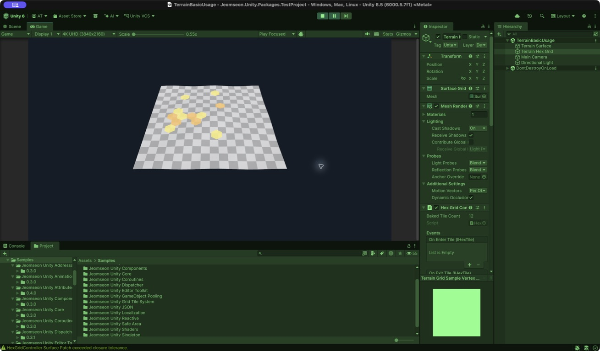

# Jeomseon Unity Grid Tile System

[한국어](README.md) | English

Builds intrinsic Hex Grids on triangle topology, separating logical state, surface bindings, and rendering.

## Quick start

Configure settings/seed, discover readable Mesh/Terrain, unfold patches, clip Hexes with barycentric binding, create geometry snapshots, and render with Mesh/structured-buffer backends. RefreshRendering after direct data edits.

## Contracts and limitations

It does not remove global regular-Hex defects on closed surfaces. Graph geodesic is a face-center path upper bound, not heat-method distance. See README for multi-surface skinning and GPU backend limits.

## Requirements

- Unity `6000.6.0f1`
- Package: `com.jeomseon.unity.grid-tile-system` `0.4.2`
- `com.jeomseon.unity.attributes`: `0.4.2`
- `com.jeomseon.unity.core`: `0.3.2`
- `com.jeomseon.unity.editor-toolkit`: `0.7.2`
- `com.unity.burst`: `1.8.30`
- `com.unity.collections`: `2.6.8`
- `com.unity.inputsystem`: `1.7.0`
- `com.unity.render-pipelines.universal`: `17.6.0`
- `com.unity.modules.terrain`: `1.0.0`
- `com.unity.modules.terrainphysics`: `1.0.0`

## Installation

Merge this into your project's `Packages/manifest.json`; preserve existing dependencies and registries.

```json
{
  "scopedRegistries": [
    {
      "name": "OpenUPM",
      "url": "https://package.openupm.com",
      "scopes": [
        "com.jeomseon"
      ]
    }
  ],
  "dependencies": {
    "com.jeomseon.unity.grid-tile-system": "0.4.2"
  }
}
```

Or use **Install package from git URL** in Package Manager:

```text
https://github.com/jeomseon0516/Unity.GridTileSystem.git#v0.4.2
```

## API usage and details

### Setup

1. Create a `HexGridSettings` asset.
2. Add colliders for readable static meshes or terrains in the scene. No surface registration is required.
3. Set the world seed with the controller Transform or `Seed Anchor`/`Seed Offset`.
4. For visualization, assign a dedicated output `MeshFilter` and `MeshRenderer` pair.
5. Run `Rebuild Tiles`. The system finds the seed surface and expands across touching surfaces automatically.

```text
Static Mesh/Terrain Adapter → Triangle topology → local unfolding patch → intrinsic hexes
→ polygon clipping → barycentric regions → geometry snapshot → mesh render backend
```

Runtime supports readable static meshes and Terrain heightfields. Terrain positions, triangles, and adjacency
are computed without cloning the entire heightfield into a Mesh, and hole faces are traversal boundaries.
Skinned meshes follow bone deformation while the grid stays on one surface. A grid spanning multiple surfaces
remains in bind pose because those surfaces do not share one deformation binding. Shared-boundary chunking and
Burst/Jobs foundations are available through the advanced APIs below.

Leaving both output references empty enables a logical-only grid with tile state and picking but no generated
render mesh; assigning only one is rejected. `HexGridSettings` owns reusable seed-selection policy through
`Seed Search Radius`, `Surface Layer Mask`, and `Preferred Surface Direction`. The controller keeps the
scene-dependent `Initial Direction`, which aligns the first hex corner in world space. `HexTileData` owns
serializable state, while `HexTile` adds UnityEvent interaction. Call
`HexGridController.RefreshRendering()` after directly applying synchronized data.



This image was captured from the current `Basic Usage` sample in Play Mode with Unity 6000.5.7f1. At a tile
radius of 0.5 it generated 126 complete hexes and excluded tiles clipped by the surface boundary.



`Terrain Usage` builds 149 tiles from virtual topology without cloning the terrain into a Mesh. This current
Play Mode capture uses zero geometry offset and the package-owned depth-biased fallback material to avoid
Terrain LOD depth conflicts without lifting the mesh from the heightfield.



The Inspector keeps the `Surface Grid` output mesh, renderer, controller bake result, and events on one object.
There is no receiver field or separate surface-registration workflow.

### Accuracy and large-grid APIs

Enable `SurfacePatchBuildSettings.SplitWhenLimitReached` to continue from frontier faces when a triangle-count
or graph-intrinsic-radius limit is reached. Frontier placements keep every patch in one intrinsic coordinate
system, each face is assigned once, and `SurfaceGridBuilder` combines partial regions from all patches into one
logical grid. Inspect `SurfacePatchSet` plus closure error, graph-geodesic upper bound, and maximum/average metric
distortion diagnostics on each patch.
`HexGridSettings` enables the same policy by default through `Split Patch When Limit Reached`.

`SurfaceGridSnapshot.Diff` reports added, removed, and rebound coordinates between versions.
`SurfaceGridChunk.CollectDirty` and `SurfaceGridChunkGeometryBuilder` rebuild only affected chunks.
`SurfaceBindingEvaluationJob` evaluates positions and normals from prepared contiguous topology/barycentric
arrays on Burst workers; the caller keeps Unity-object access and NativeArray lifetime outside the job.

`MeshSurfaceGridRenderBackend` remains the default. The optional
`StructuredBufferSurfaceGridRenderBackend` uploads vertex, index, and visual data and submits an indexed indirect
draw. Its material must implement `_SurfaceGridVertices` and `_SurfaceGridVisuals`, and needs a
`UniversalForward`/`SRPDefaultUnlit` LightMode pass to render under URP; this Core package does not
include HDRP-specific integration.

`TangentExpMapSurfaceParameterizer` is a first-order seed-tangent log-map comparison baseline, not a complete
heat-method geodesic solver. Use `SurfaceParameterizationComparison` to compare its patch count and maximum metric
distortion against Triangle Unfolding on the same input.

### Current limitations

- Automatic multi-patch coverage cannot remove the topological defects required to cover an entire sphere with
  regular hexes. The current graph geodesic is a face-centroid adjacency upper bound, not the heat method.
- The GPU backend provides a generic structured-buffer/indirect contract. Terrain-heightmap compute generation and
  render-pipeline-specific shaders/passes remain separate optional integrations driven by real project demand.
- Structured-buffer skinned deformation re-uploads the complete interleaved buffer. Combine Burst evaluation with
  chunking for large dynamic surfaces.

## Samples

Import the desired entry from **Package Manager > Samples**. Use the included Scene/Editor tool and complete its Setup step first, if required.

- [Basic Usage](Samples~/BasicUsage/README.md)
  - [HexGridBasicUsage](Samples~/BasicUsage/HexGridBasicUsage.unity)
- [Terrain Usage](Samples~/TerrainUsage/README.md)
  - [TerrainBasicUsage](Samples~/TerrainUsage/TerrainBasicUsage.unity)

## Tests

[Test sources](Tests)

Add the package ID to manifest `testables`, then execute its relevant EditMode/PlayMode assemblies in Unity Test Runner.

## Further reading

[Complete source map and package metadata](Documentation~/Overview.en.md)
- [Changelog](CHANGELOG.md)
